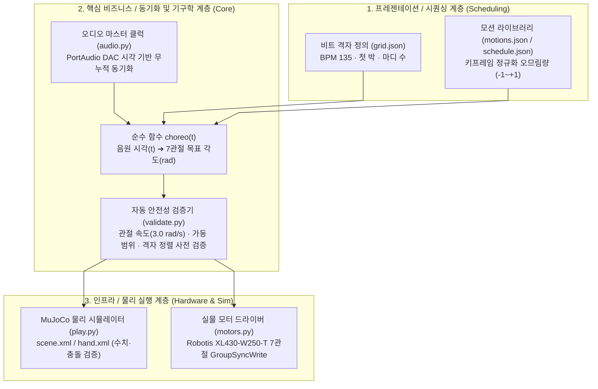

# padak-tri: 3지 다관절 로봇 손 비트 동기화 안무 제어 프레임워크

> **음원 박자에 맞춰 3지 7자유도 다관절 로봇 손의 안무를 재생하는 비트 동기화 제어 프레임워크입니다.**  
> 오디오 스트림 재생 위치를 단일 마스터 클럭으로 삼아 누적 오차 없이 MuJoCo 물리 시뮬레이션 및 실물 Dynamixel 하드웨어를 동기화합니다.

[](LICENSE)
[](https://www.python.org/)
[](https://mujoco.org/)
[]()
[]()

이전 Sim-to-Real 텔레오퍼레이션 프로젝트의 **MuJoCo 기구학/동역학 모델(`hand.xml`, `scene.xml`)과 실물 Dynamixel 모터 드라이버(`motors.py`)를 재사용**하되, 실시간 센서 입력 대신 노래 **"Heartbeat"**(2PM, 135 BPM)의 안무를 **규칙 기반 시간표(Time-scheduled)** 로 사전 계산하고, 오디오 재생 위치를 마스터 클럭으로 삼아 로봇 손이 박자에 맞춰 동작하도록 구성했습니다.

| 실물 로봇 손 구동 데모 (안무 재생) |
| :---: |
| <a href="https://youtu.be/2_KnKuTeGbY" target="_blank"></a><br>[▶️ **YouTube에서 영상 보기**](https://youtu.be/2_KnKuTeGbY) |

---

## 빠른 시작 (Quickstart)

### 1단계: 환경 구축 (Python 3.10 권장)

저장소를 클론하고 디렉토리에 진입합니다:

```bash
git clone https://github.com/ajin-robot-hand/padak-tri.git
cd padak-tri
```

사용 중인 운영체제(OS) 환경에 맞추어 가상환경을 생성하고 패키지를 설치합니다:

**Windows (PowerShell)**:
```powershell
python -m venv ..\mujoco_env
..\mujoco_env\Scripts\Activate.ps1
pip install -r requirements.txt
```

**Linux / macOS**:
```bash
python3 -m venv ~/mujoco_env
source ~/mujoco_env/bin/activate
pip install -r requirements.txt
```

<details>
<summary><b>uv 고속 패키지 매니저를 사용하는 경우 (클릭하여 펼치기)</b></summary>

```bash
# Windows
uv venv ..\mujoco_env --python 3.10 && ..\mujoco_env\Scripts\Activate.ps1
uv pip install -r requirements.txt

# Linux / macOS
uv venv ~/mujoco_env --python 3.10 && source ~/mujoco_env/bin/activate
uv pip install -r requirements.txt
```
</details>

> 📖 **OS별 실행 및 드라이버 설정**: Linux 환경의 PortAudio 라이브러리(`sudo apt-get install libportaudio2`), macOS GUI 뷰어(`mjpython`), WSL2 주의사항 등 상세 가이드는 [**docs/execution_guide.md**](docs/execution_guide.md)를 참고하세요.

---

### 2단계: 실행 및 데모 구동

주요 실행 모드에 따라 스크립트를 구동합니다:

```bash
# 음원 + MuJoCo 뷰어 구동 (스피커 음악 재생 및 손 박자 동기화)
python src/heartbeat/play.py
```

1. **안무 재생 구간**: 분석 완료된 마디 1~19(음원 0.42~34.20 s)를 재생합니다.
2. **동작 종료**: 실행 중 터미널에서 `Ctrl + C` 또는 뷰어 창에서 `q` 키를 누르면 안전하게 종료됩니다.

---

## 시스템 아키텍처

모든 안무는 음원 시각 `t`(초)를 입력받아 7관절 목표 각도(rad)를 반환하는 **순수 함수 `choreo(t)`**로 계산합니다. 내부 상태를 누적하지 않으므로, 마스터 클럭(오디오 재생 위치)만 정확하면 장시간 구동에도 드리프트나 지연 오차가 누적되지 않습니다.



---

## 핵심 기능

* **규칙 기반 무누적 시간표 (Time-scheduled Choreo)**: 실시간 비전 추정이나 오디오 주파수 반응 대신, `grid.json` 상수(BPM 135, 첫 박, 박자 수) 기반의 순수 함수 `choreo(t)`로 목표 각도를 계산하여 시간 경과에 따른 지연 누적을 방지합니다.
* **DAC 하드웨어 오디오 클럭 동기화 (`heartbeat/audio.py`)**: PortAudio 저수준 버퍼 콜백(`outputBufferDacTime`)을 활용하여 실제 스피커로 출력되는 물리적 시각을 역추산함으로써 OS 오디오 버퍼 지연을 자동 상쇄합니다 (벽시계 편차 < 0.2 ms, 시뮬레이션 어긋남 < 2 ms).
* **다중 안전 인터록 계층 (`heartbeat/validate.py`)**: 인접 키프레임 간 순간 최대 각속도(상한 3.0 rad/s), 안전 가동 범위, 8분음표 비트 격자 정렬, 음원 초과 여부를 재생 전 사전에 자동 검증합니다.
* **급가속 방지 프리롤(Preroll) 시퀀스**: 음원 재생 전 조립 상태(0 rad)에서 첫 누운 자세(-1.0)까지 부드러운 smoothstep 곡선으로 천천히 이동하고 자세 안정화를 거쳐 모터 급가속을 방지합니다.
* **Sim-to-Real 통합 제어 파이프라인**: 순수 함수 `choreo(t)` 및 안전 검증 파이프라인을 수정 없이 공유하여, MuJoCo 물리 시뮬레이션과 실물 Dynamixel 7관절 모터(`motors.py`)를 동시 또는 단독으로 동기화하여 제어합니다.

---

## 실물 하드웨어 연동 (Robotis Dynamixel XL430)

`src/motors.py`는 실물 Robotis Dynamixel(XL430-W250-T, Protocol 2.0, 위치 제어) 드라이버를 통해 음원 박자에 맞춰 7개 모터를 구동합니다.

```bash
# 1) 토크를 끈 채로 손으로 관절을 움직여 각도(rad) 및 부호 확인
python src/motors.py check --port COM3

# 2) 음원 + MuJoCo 뷰어 + 실물 로봇 손 동시 구동 (시뮬레이션 및 실물 동시 구동)
python src/heartbeat/play.py --motors --port COM3

# 3) 화면 뷰어 없이 음악 + 실물 로봇 손만 구동
python src/heartbeat/play.py --motors --no-viewer --port COM3
```

* **하드웨어 캘리브레이션**:
  ```bash
  python src/motors.py calibrate --port COM3
  ```
  수동으로 관절을 움직여 각 모터의 영점(zero tick)과 회전 방향을 측정하고 `src/motors.json`에 저장합니다.
* **실시간 동기 제어**: `AudioClock`에 맞춰 50 Hz 주기로 7개 관절에 `GroupSyncWrite` 패킷을 전송합니다.
* **페일세이프 (Fail-Safe)**: 시작 전 `validate_all()`로 속도와 가동 범위를 검증하며, 종료나 예외 발생 시 즉시 토크를 해제하고 중립 복귀합니다.
* 📖 **하드웨어 연결 및 캘리브레이션 상세 가이드**: [**docs/execution_guide.md**](docs/execution_guide.md)를 참고하세요.

---

## 성능 평가 및 계측 (KPI / Benchmark)

본 시스템은 실시간 음원 동기화 및 하드웨어 모션의 정밀도와 안정성을 정량적으로 검증합니다.

```bash
# 전구간 벤치마크 및 정량적 계측 실행
python src/heartbeat/play.py --headless
```

* **주요 평가 지표 (Key Performance Indicators)**:
  - **제어 루프 주기**: `50 Hz (주기 20 ms, 지연시간 최소화)`
  - **오디오 클럭 오차 (Audio Clock Drift)**: `12초 재생 기준 벽시계 편차 < 0.2 ms` (누적 오차 0 ms)
  - **시뮬레이션 추종 지연 (Tracking Error)**: `최대 < 2.0 ms` (허용 한계 50 ms 이내)
  - **순간 최대 각속도**: `3.0 rad/s 이내 제어` (보간 곡선별 피크 배율 반영)
  - **자가 충돌 및 가동 범위 위반**: `0건 (100% 통과)`
  - **단위 및 통합 테스트 통과율**: `64 / 64 passed (100%)`

### 동기화 및 프리롤 튜닝 파라미터

| 구분 | 파라미터 | 기본값 | 설명 및 튜닝 가이드 |
| :--- | :--- | :--- | :--- |
| **동기화** | `LEAD` | `0.050 s` | 위치 제어기(kp=12, kv=0.5) 추종 지연 보정 (`--lead` 옵션) |
| **동기화** | `AUDIO_OFFSET` | `0.0 s` | 청각적 비트 지연 보정 (손이 늦으면 음수, 빠르면 양수, `--offset` 옵션) |
| **동기화** | `VIDEO_OFFSET` | `0.966 s` | 영상↔음원 상호상관 측정 기준값 |
| **프리롤** | `preroll_seconds` | `3.0 s` | 조립 상태(0 rad) ➔ 첫 누운 자세 이동 시간 (속도 상한 보장) |
| **프리롤** | `preroll_settle_seconds` | `1.0 s` | 도착 후 중력 처짐을 제어기가 잡고 안정화되는 대기 시간 |

---

## 기구학 및 하드웨어 사양 (Kinematics Specs)

* **서보 모터**: Robotis Dynamixel XL430-W250-T (7 DOF)
* **최대 토크**: `1.4 N·m` (`forcerange="-1.4 1.4"`)
* **좌표계 및 중력축**:
  - 중력 방향: **`-Y` 축** (`gravity="0 -9.81 0"`)
  - 관절 회전축: **`+X` 축** (`axis="1 0 0"`)
* **오므림(Grasp/Close) 회전 부호 규칙**:
  - **Finger A (상단 3자유도)**: 음수(`-`) 방향 회전이 오므림
  - **Finger B, C (하단 2자유도)**: 양수(`+`) 방향 회전이 오므림
* **안전 가동 범위**: 곧게 편 자세(`0 rad`)가 범위의 **중앙**이며 양방향으로 가동 범위를 갖습니다.
  - 오므림 한계(`Q_CLOSE`): `j1` 0.3 rad, `j2` 1.2 rad (손가락 간 간섭 방지)
  - 바깥쪽 한계(`Q_OPEN`): `j1` 1.2 rad, `j2` 0.3 rad (기구학적 정지점, 손바닥쪽 관절 중심)
  - 엄지 요(`A_j0`): `±1.0472 rad` (±60° 대립 운동)
  - 관절 속도 상한: `3.0 rad/s`

> 📖 **하드웨어 모델링 원칙 및 디버깅 지침**: [**AGENTS.md**](AGENTS.md)를 참고하세요.

---

## 테스트 실행

```bash
# 전체 단위 및 통합 테스트 실행 (64개 테스트 항목)
pytest tests
```

* `tests/test_heartbeat.py`: 비트 격자 수식, `choreo(t)` 관절 계산, 시간표 유효성, 프리롤 속도 상한 검증
* `tests/test_motors.py`: 가상 시리얼 환경에서 Dynamixel 통신, 안전 범위 제한, 회전 부호 규칙 검증

---

## 프로젝트 구조

```
padak-tri/
├── docs/                 # 심층 기술 문서 및 실행 가이드
├── src/                  # 메인 소스 코드 및 실행 엔트리포인트
│   ├── heartbeat/play.py # 음원 비트 동기화 안무 재생 (Sim / Real)
│   ├── run_sim.py        # 독립 MuJoCo 시뮬레이션 데모 (코사인 궤적)
│   └── motors.py         # 실물 Dynamixel 모터 진단(check) 및 캘리브레이션(calibrate)
├── tests/                # 단위 및 통합 테스트 스위트 (pytest)
└── AGENTS.md             # 에이전트 작업 지침 및 하드웨어 모델링 원칙
```

> 📖 **모듈별 전체 파일 목록 및 세부 아키텍처 명세**: [**docs/execution_guide.md**](docs/execution_guide.md#2-아키텍처-및-모듈-구성-architecture--module-specifications)의 **아키텍처 및 모듈 구성** 절을 참고하세요.

---

## Acknowledgments

본 프로젝트는 다음 오픈소스 소프트웨어를 활용합니다:

* [MuJoCo](https://mujoco.org/) (DeepMind) - 고속 다체 동역학 물리 시뮬레이션 엔진
* [ROBOTIS Dynamixel SDK](https://emanual.robotis.com/docs/en/software/dynamixel/dynamixel_sdk/overview/) - XL430-W250-T 액추에이터 통신 및 동기 제어 (Protocol 2.0)
* [SoundDevice & SoundFile](https://python-sounddevice.readthedocs.io/) - PortAudio 기반 고정밀 오디오 재생 및 실시간 DAC 클럭 스트리밍
* [NumPy](https://numpy.org/) - 기구학 및 궤적 수치 계산

---

## License

이 프로젝트는 [MIT License](LICENSE)를 따릅니다. 세부 라이선스 전문은 [LICENSE](LICENSE) 파일을 참조하세요.
